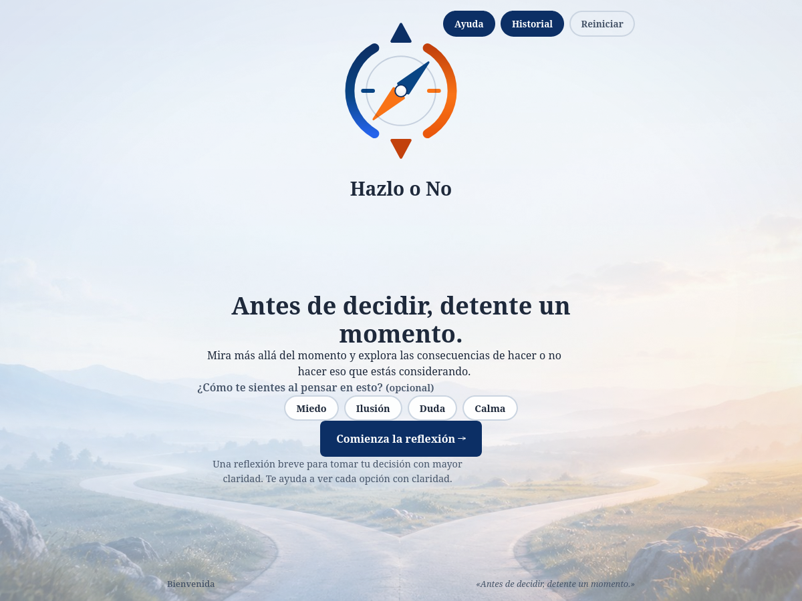
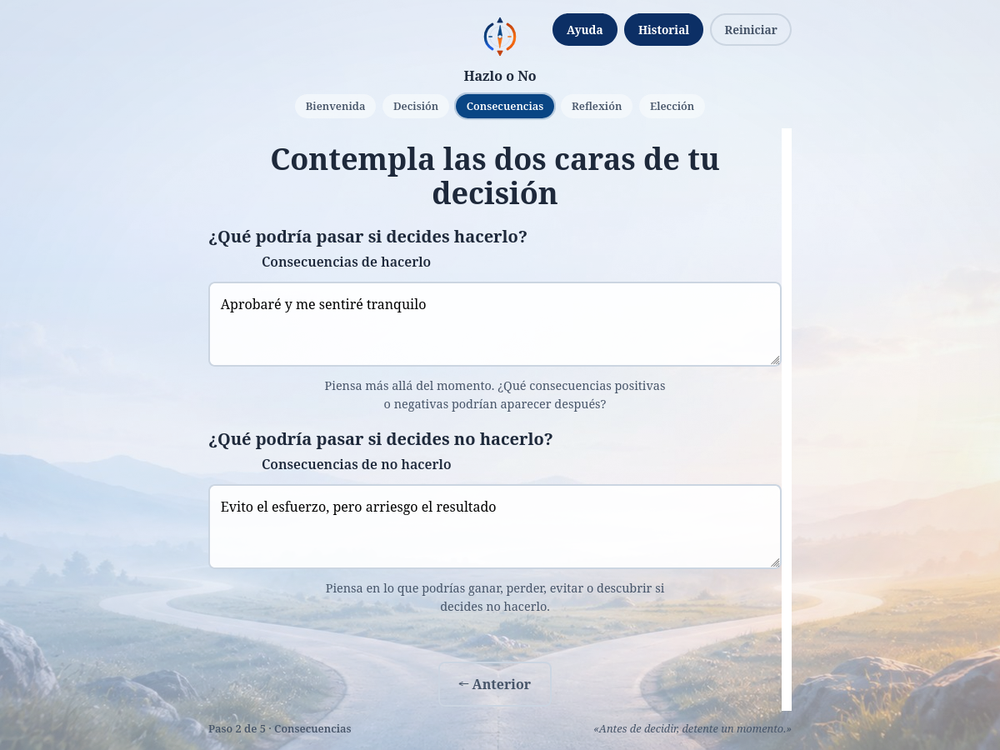
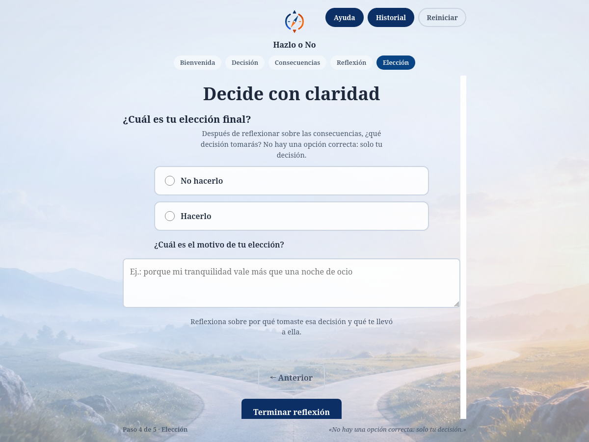
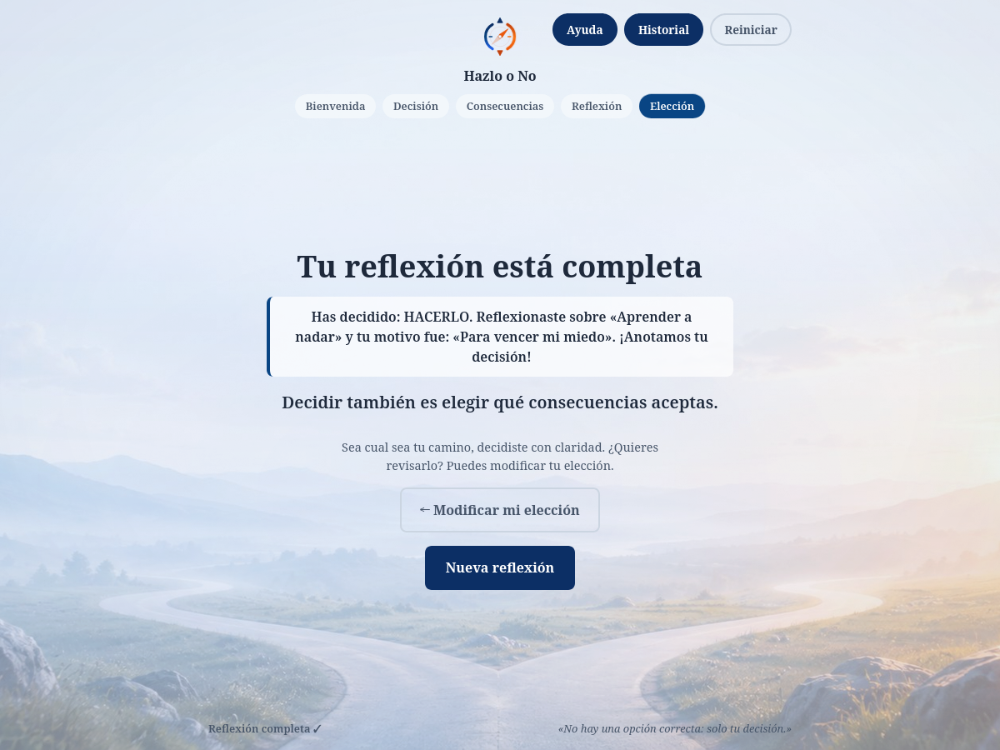
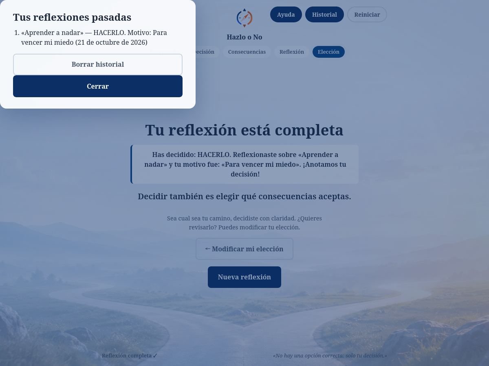

<p align="center">
  
</p>

<h1 align="center">Hazlo o No</h1>

<p align="center"><strong>Una pausa consciente antes de decidir.</strong><br>
Una herramienta para detenerte, ver las dos caras de una decisión y elegir con claridad.<br>
Sin cuentas, sin servidor, sin analítica: todo se queda en tu equipo.</p>

<p align="center">
  <a href="https://cristiancv22.github.io/HazloONo/"></a>
  <a href="https://github.com/CristianCV22/HazloONo/actions/workflows/verificar.yml"></a>
  <a href="https://github.com/CristianCV22/HazloONo/actions/workflows/publicar.yml"></a>
  <a href="LICENSE"></a>
  <a href="PRINCIPIOS.md"></a>
</p>

---

## Qué es

**Hazlo o No** es un momento de pausa. Antes de decidir, te lleva por un
camino corto y guiado: qué estás considerando, qué pasa si lo haces, qué
pasa si no lo haces, qué es lo importante para ti y, al final, tu elección.

No juzga ni persuade. Es un espejo del proceso de decisión.

**No es** una lista de tareas, ni un diario, ni un coaching. Es un espacio
de unos minutos para pensar con la cabeza más libre.

## Qué se ve

<table>
<tr>
<td width="50%"></td>
<td width="50%"></td>
</tr>
<tr>
<td align="center"><em>La primera pantalla: una pausa antes de decidir</em></td>
<td align="center"><em>El umbral: el clic se convierte en pausa consciente</em></td>
</tr>
<tr>
<td></td>
<td></td>
</tr>
<tr>
<td align="center"><em>Contemplar las dos caras de la decisión</em></td>
<td align="center"><em>La elección: la aguja se inclina hacia lo que consideras</em></td>
</tr>
<tr>
<td></td>
<td></td>
</tr>
<tr>
<td align="center"><em>El cierre: un resumen neutro de tu decisión</em></td>
<td align="center"><em>El historial: tus reflexiones pasadas, solo en tu equipo</em></td>
</tr>
</table>

> Las capturas se generan con la aplicación real: `npm run capturas`.

## Cómo se usa

1. **«Comienza la reflexión»** — no te mete de lleno: aparece un *umbral*,
   un segundo tiempo para leer que no hay prisa. Si quieres, puedes
   respirar 4-4-4 antes de seguir.
2. **Decisión** — qué estás considerando.
3. **Consecuencias** — qué pasa si lo haces y qué pasa si no lo haces.
4. **Reflexión** — qué es lo importante para ti y qué ganas o sacrificas.
5. **Elección** — «Hacerlo» o «No hacerlo», y por qué.

Al terminar tienes un resumen. Si te arrepientes (que también es decidir),
puedes volver atrás y cambiar la opción: la aguja y el ambiente reaccionan
al instante y tu historial se actualiza.

Tu reflexión **se guarda sola** en el navegador. Si cierras la pestaña a
media camino, al volver la tienes donde la dejaste.

## Lo que no hace (y por qué es una decisión)

- **No hay cuentas ni registro.** No hay a quién escribirle, ni qué
  perder.
- **No sale nada de tu equipo.** El borrador y el historial viven en
  `localStorage`; no hay servidor, ni analítica, ni rastreadores. Ni
  siquiera para saber cuántas personas lo usan.
- **No hay "mejoras" ni notificaciones push.** No te va a requerir la
  atención.

Si algún día hiciera falta un servidor, sería una decisión nueva y
explícita: el principio está escrito en [`PRINCIPIOS.md`](PRINCIPIOS.md).

## ♿ Accesibilidad

La herramienta es para pensar con calma; no puede exigir calma a quien
tiene una dificultad.

- HTML5 semántico: `header`, `main`, `nav`, `section`, `fieldset`,
  `legend`, `label`, `dialog`.
- `aria-current="step"` en el indicador de progreso; `aria-live` para el
  resumen; `role="alert"` para los errores y `role="status"` para los
  avisos.
- Los errores **nombran el campo** que falta y lo asocian a él
  (`aria-invalid` + `aria-describedby`).
- El foco se mueve al título de cada paso (se aplaza al fotograma en que
  la sección ya es visible, para que el lector de pantalla lo anuncie
  también con movimiento reducido).
- Contraste WCAG AA; foco visible; `prefers-reduced-motion` respetado
  siempre, con opción de activarlo o desactivarlo.
- Sin `confirm()` ni `alert()`: las confirmaciones son doble pulsación
  en botones nativos, usables con teclado.
- Sin JavaScript la página **se lee y se puede escribir** (con un aviso
  que lo explica); sin almacenamiento, la app sigue funcionando.

## 🧱 Decisiones técnicas

- **HTML primero.** El contenido completo está en el marcado y se lee sin
  JavaScript. CSS y JS lo mejoran, no lo sostienen.
- **Cero dependencias.** Ni framework, ni bundler, ni bibliotecas: módulos
  ES nativos, `<dialog>`, `:has()`, `@property`. El `package.json` no
  tiene `dependencies`; las herramientas se usan bajo demanda con `npx`.
- **Degradación elegante en cada capa.** Sin JS, sin almacenamiento, sin
  `@property`, sin el módulo ES (por ejemplo, abierto como `file://`):
  siempre hay una versión que funciona.
- **Un sistema, no un dibujo.** El logotipo es un conjunto de piezas: el
  arco se define una vez y se reutiliza, la aguja es el dilema y también
  el indicador de progreso, y toda la coloración vive en variables CSS.
- **Todo por variables.** Tokens en `styles/variables.css`, modificadores
  de estado en `styles/states.css`. JavaScript sólo escribe clases y el
  atributo `hidden`.
- **Grafo de módulos acíclico.** Las dependencias van siempre hacia
  abajo, así que el orden de evaluación de los módulos nunca importa.
  `npm run test:grafo` lo comprueba, incluida la detección de ciclos.

Los detalles, con el porqué de cada decisión, están en
[`PRINCIPIOS.md`](PRINCIPIOS.md).

## 📂 Estructura

```
HazloONo/
├── index.html          # Estructura semántica: 5 pasos del flujo + cierre
├── styles/             # CSS por componente
│   ├── variables.css      # Tokens: @property, paleta de marca, texto (:root)
│   ├── base.css           # Reset, layout, tipografía y responsive
│   ├── components/        # header · logo · form · buttons
│   └── states.css         # Modificadores de estado y accesibilidad
├── scripts/            # JS en módulos ES (type="module")
│   ├── main.js             # raíz: importa, inicializa y arranca
│   ├── datos.js            # estado y referencias al DOM (no importa nada)
│   ├── almacen.js          # almacenamiento local y preferencias
│   ├── state.js            # navegación, borrador e historial
│   └── components/         # logo · umbral · form · modal
├── assets/
│   ├── images/             # fondo.jpg, favicon.svg, logo-vivo.svg
│   └── capturas/           # capturas para el README (npm run capturas)
├── tests/              # Pruebas (Node.js, sin dependencias)
│   └── flujo.test.js       # Prueba funcional del flujo completo
├── pruebas/            # Verificación en navegador real
│   ├── navegador.js          # rutas portables (navegador, puertos, perfiles)
│   ├── capturas.js           # genera las capturas del README
│   ├── sonda-cdp.js          # coreografía de apertura, muestreo de estilos
│   ├── verificar-*.js        # anulación de movimiento, borrador, grafo
│   └── probe-*.js            # sondas puntuales
├── .github/workflows/  # CI (verificar) y publicación (Pages)
├── PRINCIPIOS.md       # Las 11 reglas del proyecto
├── CONTRIBUTING.md     # Cómo trabajar aquí
├── CHANGELOG.md        # La historia
├── SECURITY.md         # Cómo reportar un problema
└── LICENSE             # MIT
```

## 🚀 Probar

```bash
git clone https://github.com/CristianCV22/HazloONo.git
cd HazloONo
python -m http.server 8000     # → http://localhost:8000
```

> Hay que servirlo por HTTP: los módulos ES no se cargan desde `file://`.
> Si se abre el fichero directamente, la app degrada al layout sin
> JavaScript — funciona, pero sin interacción.

**Verificar que todo está bien** (no hace falta instalar nada):

```bash
npm run verificar     # pruebas + grafo de módulos + los dos linters
```

| Comando | Qué comprueba |
|---|---|
| `npm test` | El flujo completo de la reflexión (234 aserciones, Node puro) |
| `npm run test:grafo` | Que el grafo de módulos es completo, consistente y **acíclico** |
| `npm run lint` | ESLint (formato plano, vía `npx`) |
| `npm run lint:css` | Stylelint (formato plano, vía `npx`) |
| `npm run capturas` | Regenera las capturas del README (necesita un navegador) |

Las mismas comprobaciones se ejecutan solas en cada push y en cada PR.

**Verificación en un navegador real**: las sondas de `pruebas/` conducen
Edge, Chrome o Firefox en modo headless. Son portables: el navegador, el
puerto, la URL y la carpeta de perfiles se resuelven en
`pruebas/navegador.js` (variables de entorno `NAVEGADOR`,
`PUERTO_SERVIDOR`, `URL_PAGINA` y `CARPETA_PERFILES`).

## 🌐 Publicar

Cada push a `main` despliega la web en **GitHub Pages**
(<https://cristiancv22.github.io/HazloONo/>). El sitio es el propio
proyecto: HTML, CSS y JavaScript sin compilar.

El flujo de trabajo (`.github/workflows/publicar.yml`) copia al artefacto
**sólo** lo que es la web (`index.html`, `styles/`, `scripts/`,
`assets/`): el código fuente, las pruebas y los workflows se leen en
GitHub, no se sirven.

## 🔄 Flujo de la reflexión (5 pasos)

1. **Bienvenida** — «Antes de decidir, detente un momento.» Al pulsar
   «Comienza la reflexión» aparece el **umbral**: un segundo tiempo que
   convierte el clic en pausa consciente, con un anillo que respira.
   «Respirar conmigo» lanza una guía 4-4-4 de 3 ciclos.
2. **Decisión** — ¿qué decisión tienes que tomar?
3. **Consecuencias** — ¿qué pasa si lo haces? ¿Y si no lo haces?
4. **Reflexión** — lo importante para ti + un resumen en vivo.
5. **Elección** — elección final (radios) + motivo → cierre con resumen.

## 💾 Persistencia local

- **Borrador** (`hazlono-borrador`): la reflexión en curso. Se guarda
  300 ms después de la última tecla, al elegir, al avanzar y al cerrar la
  pestaña (con `beforeunload`, `pagehide` y `visibilitychange`, porque
  `beforeunload` no es fiable en móvil).
- **Historial** (`hazlono-historial`): hasta 50 reflexiones terminadas,
  con la más reciente primero. Una reflexión es **una entrada**: si
  vuelves a modificarla, se actualiza. Se borra con doble pulsación
  (sin `confirm()`).
- **Preferencia de animaciones** (`hazlono-animacion`): seguir al
  sistema, activar o desactivar. Se aplica en el `<head>`, antes del
  primer pintado.

Si el almacenamiento está denegado o lleno, la app sigue funcionando
(sólo se pierde la persistencia) y te avisa al abrir «Ayuda».

## 🎯 Anatomía del logotipo (SVG)

El logo es una **rueda de decisión** construida como un sistema:

- **`<defs>` + `<use>`**: el arco se define *una* vez y se reutiliza dos
  veces (el naranja es el espejo del azul). Cambiar el arco cambia ambos
  lados.
- **La aguja es el dilema**: en reflexión está *dividida* (mitad azul,
  mitad naranja: las dos posibilidades, vivas e iguales, sin sesgo). Al
  decidir se viste del color elegido y su cola se desvanece.
- **Degradados de 3 paradas** (profundo → principal → vivo) en los arcos;
  brillo radial en el centro. El trazo se define en CSS, no en atributos.
- **Onda de decisión**: pulso único que expande desde la rueda al elegir
  (se reactiva al cambiar de opción).
- **Escala de grosores**: 28 (anillo) · 12 (ejes) · 8 (marcadores) ·
  6 (aguja) · 5 (onda) · 4 (centro).
- **La aguja es el indicador de progreso**: barre de izquierda a derecha
  según el paso, centrada en «Consecuencias» — el momento de ver las dos
  caras.
- **`<title>` + `<desc>`**: el SVG de la página es decorativo
  (`aria-hidden`); el `<h1>` es su texto alternativo. El favicon y el
  logo animado del README llevan los suyos.

## 🌊 Ambiente vivo

- El **fondo** entra con fade + zoom muy suave y luego *deriva*
  lentamente: manchas azul/naranja que respiran.
- Al elegir, la pantalla se **tiñe** sutilmente y el **color se funde**
  (0.9 s, gracias a `@property`): azul para «No hacerlo», naranja para
  «Hacerlo».
- El indicador de progreso pulsa en el paso activo; la aguja oscila ±1.5°
  mientras piensas.
- Cada paso entra escalonado; los botones dan un pulso de atención.
- **Viñeta cinematográfica** (6 % en las esquinas) y grano de película
  estático (4 %): carácter, sin ruido.
- En la elección, al pasar el puntero sobre una opción, la aguja se
  inclina hacia ella (±12°): considerar no es comprometerse.

Todo se desactiva con `prefers-reduced-motion` (salvo que el usuario
elija «Activar»).

## 📖 Documentos

| Documento | Para qué |
|---|---|
| [`PRINCIPIOS.md`](PRINCIPIOS.md) | Las 11 reglas del proyecto (el «Documento Maestro» que cita el código) |
| [`CONTRIBUTING.md`](CONTRIBUTING.md) | Cómo trabajar aquí: estilo, pruebas y proceso de PR |
| [`CHANGELOG.md`](CHANGELOG.md) | La historia del proyecto |
| [`SECURITY.md`](SECURITY.md) | Cómo reportar un problema de seguridad |

## 📄 Licencia

MIT — ver [`LICENSE`](LICENSE).
